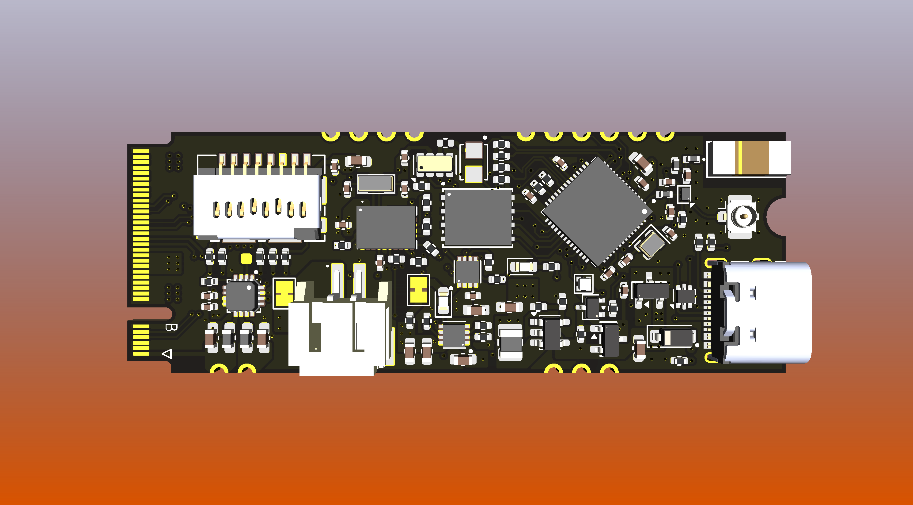
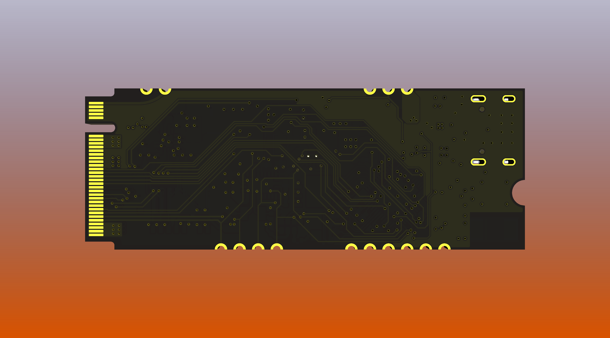

# NX-Edge

> **Modular Embedded Development Platform**  
> *M.2 2260 Key B • 6-Layer Stackup • ESP32-S3 Dual-Core 240MHz • Autonomous LiPo Power-Path & Fuel Gauge • Dual-Antenna RF Front-End • 9-DOF IMU • I2S Audio Amp • 4-bit MicroSD*

---

<p align="center">
  
</p>
<p align="center">
  <em>NX-Edge Top View — 100% single-sided top assembly with 45° ESP32-S3, QSPI Flash, BNO085 IMU, RV-3028 RTC, MAX98357A Audio Amp, MicroSD slot, LiPo Charger & Fuel Gauge.</em>
</p>

<p align="center">
  
</p>
<p align="center">
  <em>NX-Edge Bottom View — Flat single-sided surface with M.2 Key B docking fingers, NO NVME warning, IMU coordinate triad, cut-safe jumpers [SW] & [LED], and GAIN test pad.</em>
</p>

---

> [!TIP]
> 📖 **Technical Documentation Available:**  
> * **[NX-Edge Hardware Reference Manual](docs/HARDWARE_MANUAL.md):** Detailed pinouts, subsystem floorplan, I2C register maps, power-path precautions, and quickstart code.
> * **[NX-Edge RF Design Guide](docs/RF_DESIGN_GUIDE.md):** 2.4 GHz transmission line impedance derivations ($Z_0 = 51.44\,\Omega$), stackup equations, and matching network BOM values.

---

## Overview

The **NX-Edge** is an embedded development board based on the ESP32-S3, built in an M.2 2260 form factor. It integrates power management, audio amplification, 9-DOF motion tracking, RTC, and microSD storage onto a single board, designed to interface with custom carrier boards via an M.2 Key B connector or edge breakout headers.

Built on a **6-layer PCB** with **100% single-sided component placement** (zero components on the bottom layer):

* **M.2 2260 Form Factor ($22 \times 60\text{ mm}$):** Fits the ESP32-S3 and all peripherals within the 60 mm board length.
* **M.2 Key B Edge Connector (75 pins):** Custom pinout routing power, audio, I2C, UART, SDMMC, and all free GPIOs to carrier boards.
* **Edge Breakouts (2.54 mm pitch):** 15 edge breakout holes for bench testing and wiring. The left side breaks out logic/power/I2C/UART, and the right side breaks out NeoPixel and speaker outputs.
* **Flat Bottom Surface:** 100% single-sided top assembly with zero components on the bottom, leaving the back flat for low-profile mounting.

> [!IMPORTANT]
> **NX Custom Maker Interconnect (Non-PC Hardware):**  
> While the board utilizes the standard mechanical **M.2 Key B form factor and connector**, the pinout is a **custom, high-power maker standard** (similar to SparkFun MicroMod). The M.2 connector routes raw battery power, high-current 5V rails, speaker outputs, and 3.3V GPIOs directly to custom carrier boards. **Do NOT plug this board into a standard PC motherboard M.2 NVMe/SATA slot.**

---

## Current Hardware Implementation Status

| Subsystem / Block | Status | Key Components & Implementation Details |
| :--- | :---: | :--- |
| **Compute Core** | **Routed** | ESP32-S3 (bare QFN-56 @ 45°), 40 MHz 2016 crystal with symmetrical wings, decoupling network on power rails. |
| **Flash Memory** | **Routed** | 16 MB Winbond `W25Q128JVPIQ` (WSON-8), inline decoupling, Quad-SPI bus routed on internal Layer 3 stripline. |
| **RF Front-End** | **Routed** | Ignion `NN02-201` ceramic antenna + Hirose U.FL receptacle + Infineon `BGS12WN6` SPDT RF switch (`RF_CTRL`). |
| **USB Type-C** | **Routed** | Reversible Type-C receptacle, `USBLC6-2SC6` ESD array, dual $5.1\,\text{k}\Omega$ CC pulldowns (`R20`/`R21`), D+/D- internal stripline. |
| **LiPo Charging** | **Routed** | TI `BQ25170` autonomous linear charger (600–800 mA), status LED, horizontal JST-PH 2.0mm connector (`P1`/`P2`). |
| **Battery Power Switch** | **Routed** | Solder jumper & switch pads `JP2` (`[ SW ]`) to wire a physical power toggle switch (must be ON to charge). |
| **Buck Regulator** | **Routed** | TI `TLV62569` synchronous buck converter delivering continuous **3.3V @ 2.0A** with low ripple. |
| **Fuel Gauge** | **Routed** | Maxim `MAX17048` ModelGauge™ I2C fuel gauge (`0x36`) for cell voltage ($V_{CELL}$) and SoC% without IR drop. |
| **NeoPixel Driver** | **Routed** | P-FET `Q2` (DMP3130L-7) + NPN `Q3` (BC847W) on `IO12` with 3 castellated pads (`VN`, `NPD_IN`, `GND`) for high-power strips. |
| **Onboard Indicators**| **Routed** | Onboard RGB NeoPixel (WS2812B/SK6812) powered from `VN` + User LED (LED13 / `D3`) with resistor `R13`. |
| **6-Layer Stackup** | **Routed** | 6-layer stackup with 0.45 mm / 0.25 mm standard through-hole vias for clean signal integrity. |
| **MicroSD Slot** | **Routed** | Molex 105162 push-pull slot running in native **4-bit hardware SDMMC** mode via dedicated internal stripline bus. |
| **Motion Sensor** | **Routed** | CEVA / Hillcrest Labs `BNO085` 9-DOF IMU with dedicated 32.768 kHz quartz crystal and sensor-fusion engine. |
| **Audio Amplifier** | **Routed** | Maxim `MAX98357A` I2S Class-D mono amplifier delivering up to 3.2W into 4Ω directly from `VIN` (Bridge-Tied Load speaker output). |
| **RTC Subsystem** | **Routed** | Micro Crystal `RV-3028-C7` extreme low-power ($45\,\text{nA}$) real-time clock with backup capacitor. |
| **Hardware Buttons** | **Routed** | Dual Alps `SKTAAAE010` ($0.53\text{ mm}$ height) tactile buttons for **BOOT** (`IO0`) and **RST** with hardware Power-On-Reset (POR) delay circuit. |
| **Routing Status** | **100% Complete** | 100% routed on all 6 layers using **standard through-hole vias only** (0 blind, 0 buried). |

---

## 6-Layer Stackup Architecture

To ensure signal integrity and separate the 2.4 GHz RF stage from digital signal buses, the NX-Edge uses a **6-layer symmetrical stackup**:

| Layer | KiCad Layer | Type | Copper Role & Signal Integrity Function |
| :---: | :---: | :---: | :--- |
| **L1** | `F.Cu` | Mixed / Top | Component mounting, 2.4 GHz RF transmission line, localized power pours (`VIN`, `+3V3`, `VBAT`). |
| **L2** | `In1.Cu` | Plane | **Solid Ground Plane (GND):** Return path and shield directly below Top layer. |
| **L3** | `In2.Cu` | Stripline Sig | **Internal Signals:** Shielded striplines for **USB D+/D-**, **Flash Quad-SPI**, and **SDMMC**. |
| **L4** | `In3.Cu` | Power Plane | **Power Plane Mosaic:** Low-impedance internal distribution for `+3V3`, `VBUS`, and `VBAT`. |
| **L5** | `In4.Cu` | Plane | **Secondary Solid Ground Plane (GND):** Complete ground shield referencing Bottom layer. |
| **L6** | `B.Cu` | Mixed / Bottom | Non-critical escape routing, switched `VN` power plane, M.2 docking fingers, and edge test pads. |

* **Via Geometry & Cost Efficiency:** Optimized to **0.45 mm pad diameter / 0.25 mm drill hole** (0.1 mm annular ring). The entire board is routed using **standard through-hole vias only** (0 blind, 0 buried, and 0 laser micro-vias), keeping prototype fabrication compatible with standard, low-cost fab pools.

---

## Power Architecture & Power-Path Topology

The NX-Edge implements an autonomous, low-loss **Power-Path management architecture**:

```text
  USB-C (VBUS 5V) ──► [Schottky D2] ──────────┐
                                              │
  LiPo (VBAT) ────► [Hard-Cut JP2] ──► [Q1] ──┴─► [ VIN ] (Automatic System Rail)
                                        ▲           │
                                        │ Gate      ├─► [TLV62569 Buck] ──► +3V3 (2.0A)
                                  (VBUS Controlled) │
                                                    ├─► [MAX17048 Gauge] (I2C SoC Monitoring)
                                                    │
                                                    └─► [Q2 P-FET / Q3 NPN] ──► VN (Switched NeoPixel Rail)
                                                              ▲
                                                              │ GPIO12 (CTRL_NP)
```

1. **Automatic Power-Path Node (`VIN`):**
   * Sourced through Schottky diode from USB `VBUS` ($5.0\text{V}$) or low-loss P-MOSFET from battery `VBAT` ($3.7\text{–}4.2\text{V}$).
   * **USB Connected:** `VBUS` holds the P-FET gate high, completely isolating the battery from system discharge. `VIN` runs directly on USB power ($\approx 4.8\text{–}5.0\text{V}$).
   * **Battery Only:** When USB is disconnected, a gate pull-down immediately engages the P-FET ($R_{DS(on)} \approx 30\text{ m}\Omega$), supplying `VIN` with virtually zero voltage drop.
2. **System Buck Regulator (`TLV62569`):**
   * Synchronous step-down buck converter delivering **$3.3\text{V} @ \mathbf{2.0\text{A}}$ continuous** with $>95\%$ efficiency.
   * Powers the ESP32-S3, Flash, sensors, and peripherals cleanly without thermal throttling.
3. **Autonomous LiPo Charger (`BQ25170`):**
   * Standalone linear charger powered from `VBUS` configured for $600\text{–}800\text{ mA}$ charging with NTC thermistor input.
   * **Decoupled Charging:** Because the system and external LEDs run from `VIN`, charging current is never hijacked by system load.
4. **ModelGauge™ Fuel Gauge (`MAX17048`):**
   * Precision I2C fuel gauge (`0x36`) monitoring cell voltage directly at the battery connector. Reports cell voltage ($V_{CELL}$ in mV), State of Charge (SOC %), and rate of change over I2C without needing external ADC dividers.
5. **Smart NeoPixel Power-Cut (`VN`):**
   * High-side P-MOSFET `Q2` driven by NPN BJT `Q3` controlled via **GPIO12 (`CTRL_NP`)**.
   * In Standby/Deep Sleep (`CTRL_NP = LOW`), power to both onboard and external NeoPixels is cut to $0.0\text{V}$, eliminating quiescent current draw.

---

## RF Front-End & Antenna Switch

* **RF Switch:** Infineon **`BGS12WN6`** SPDT switch ($0.7 \times 1.1\text{ mm}$) rated up to $6\text{ GHz}$ with $<0.3\text{ dB}$ insertion loss.
* **50Ω Transmission Lines:** All RF lines routed on `F.Cu` with $W = 0.150\,\text{mm}$ over $0.100\,\text{mm}$ prepreg ($Z_0 = 51.44\,\Omega$, $\text{VSWR} = 1.028:1$). See the **[RF Design Guide](docs/RF_DESIGN_GUIDE.md)** for detailed math and matching BOM values.
* **Control:** Controlled via **`RF_CTRL`** (`GPIO10`):
  * **Low (Default):** On-board high-efficiency **Ignion NN02-201** ceramic chip antenna with 50Ω lumped matching network (`C13`, `L3`, `L2`).
  * **High:** Micro-coaxial **Hirose U.FL / IPEX** receptacle for external antenna routing out of metal, carbon fiber, or shielded enclosures.

---

## Mechanical Specifications

* **Form Factor:** M.2 2260 Key B ($22.0\text{ mm} \times 60.0\text{ mm}$).
* **Connector Type:** 75-pin M.2 Key B card edge connector.
* **PCB Thickness:** **$0.80\,\text{mm} \pm 10\%$** ($0.8\text{ mm}$ finished thickness, compliant with the official PCI-SIG M.2 Card Electromechanical Specification).
* **Component Clearance:** 100% single-sided top placement. Completely flat bottom surface (Zero-Z) for ultra-low-profile carrier mounting.
* **Silkscreen & Hardware Annotations:**
  * **`NO NVME`** boxed warning over bottom gold fingers to prevent accidental insertion into standard PC motherboard slots.
  * Dual-purpose **`B ▽`** marker designating both `SW2` (BOOT) and the mechanical Key B notch.
  * **`[ SW ]`** (`JP2`) and **`[ LED ]`** (`JP1`) boxed cut-jumpers with internal copper keepouts beneath the cut bridge.
  * **`G`** silkscreen marking audio GAIN test point `TP1`.
  * IMU 3-axis coordinate triad ($X, Y, Z$) and chip boundary outline.
  * MicroSD card insertion icon with contact orientation.
* **Edge Breakouts (2.54 mm pitch):** 15 edge breakout holes:
  * **Left Edge (Logic/Power):** `J9` (6-pin: `3V3`, `GND`, `RST`, `IO0`, `IO1`, `IO11`) and `J5` (4-pin: `IO8`/SDA, `IO9`/SCL, `RX`, `TX`).
  * **Right Edge (Power/Audio):** `J7` (3-pin: NeoPixel `VN`, `NPD_IN`, `GND`) and `J2` (2-pin: Speaker `Audio+`, `Audio-`).
  * *Breadboard & Prototyping Note:* While each individual rail uses standard 2.54 mm pitch and both sides align at the exact same height, the $22.0\text{ mm}$ board width is dictated by the M.2 standard and does not fall on a 2.54 mm grid ($22\text{ mm} \approx 8.66\text{ pitches}$). Vertical pin headers populated on both edges simultaneously will not span a single breadboard across the center ravine.  
    **Recommendation:** Solder pin headers to the IO/logic side (`J9`/`J5`) to plug into a breadboard. For the power/output side (`J7` NeoPixel and `J2` Audio), direct wire soldering or fly-leads are recommended anyway for power delivery and signal integrity—or simply leave them unpopulated if not needed.

---

## License & Credits

* **Hardware Design:** Licensed under the [CERN Open Hardware Licence Version 2 - Strongly Reciprocal (CERN-OHL-S)](https://ohwr.org/cernohl).
* **Engineering & Ownership:** Conceptualized, engineered, schematics, PCB layout, and testing by [@Ghost3379](https://github.com/Ghost3379).
* **Tooling & AI Transparency:** Antigravity IDE (Gemini 3.8) was used for brainstorming and documentation assistance. All hardware architecture, schematics, routing, and layout decisions are 100% human-designed and verified.
