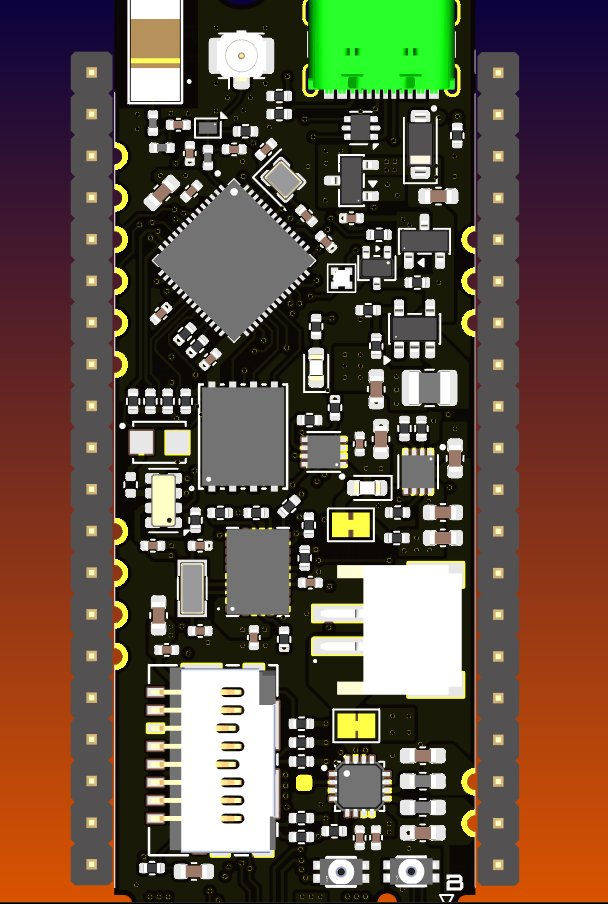

# NX-Edge Hardware Reference Manual

> **Document Version:** 1.0  
> **Form Factor:** M.2 2260 Key B (6-Layer Single-Sided PCB)  
> **Compute Core:** Espressif ESP32-S3 (Dual-Core Xtensa LX7 @ 240 MHz, 512 KB SRAM, 16 MB QSPI Flash)

---

## 1. Quick Reference & Operating Limits

> [!CAUTION]
> **CUSTOM MAKER PINOUT — NOT A STANDARD PC MOTHERBOARD COMPONENT!**  
> While the NX-Edge mechanically docks into standard **M.2 Key B sockets**, the pinout is a **custom maker standard** (similar to SparkFun MicroMod). The card edge routes raw battery voltage (`VBAT`), high-current 5V rails, and Class-D speaker outputs.  
> **Do NOT plug this board into a PC motherboard, laptop, or standard M.2 NVMe/SATA USB enclosure.**

| Parameter | Symbol | Min | Typ | Max | Unit | Notes |
| :--- | :---: | :---: | :---: | :---: | :---: | :--- |
| **USB Input Voltage** | $V_{BUS}$ | 4.75 | 5.0 | 5.5 | V | Standard USB Type-C input. |
| **Battery Input Voltage** | $V_{BAT}$ | 3.0 | 3.7 | 4.2 | V | 1S LiPo / Li-Ion single cell only. |
| **System Power Rail** | $V_{IN}$ | 3.0 | 4.2–5.0 | 5.5 | V | Auto-switched: $V_{BUS} - V_{diode}$ or $V_{BAT}$. |
| **System Logic Rail** | $+3V3$ | 3.25 | 3.3 | 3.35 | V | Output from TI TLV62569 buck converter. |
| **Buck Max Continuous Current** | $I_{3V3}$ | — | — | 2.0 | A | Continuous capacity across all 3.3V logic. |
| **LiPo Charge Current** | $I_{CHG}$ | 600 | 700 | 800 | mA | Standalone TI BQ25170 linear charger. |
| **GPIO Logic Level** | $V_{IO}$ | 0.0 | 3.3 | 3.6 | V | **NOT 5V tolerant.** Absolute max is 3.6V. |
| **Operating Temperature** | $T_{OPR}$ | -20 | 25 | 70 | °C | Industrial grade passive & active components. |

---

## 2. Board Architecture & Layout Map

All active ICs, connectors, and passives are populated on the **Top layer (`F.Cu`)**. The bottom is flat copper and solder mask with zero SMD components.

<p align="center">
  
</p>
<p align="center">
  <em>NX-Edge Top-Down 3D View — M.2 2260 Key B form factor with single-sided top assembly.</em>
</p>

### Subsystem Block Overview

```text
 ┌────────────────────────────────────────────────────────────────────────┐
 │                              [ USB-C ]                                 │
 │  [Chip Ant]  [U.FL]  [RF Switch]                     [Ignion Antenna]  │
 │                                                                        │
 │              [ ESP32-S3 ]        [Winbond 16MB Flash]                  │
 │             ( bare QFN-56 )          ( WSON-8 )                        │
 │                                                                        │
 │  [J9 Logic]  [ BNO085 IMU ]      [ TI TLV62569 Buck (3.3V @ 2A) ]      │
 │  (6-pin THT) [ 32.768k XTAL]     [ BQ25170 LiPo Charger (800mA) ]      │
 │                                                                        │
 │  [J5 Serial] [ RV-3028 RTC ]     [ MAX17048 Fuel Gauge ]   [J7 NeoPix] │
 │  (4-pin THT) [ C34 Supercap]     [ Q2/Q3 NeoPixel Switch]  (3-pin THT) │
 │                                                                        │
 │              [ MicroSD Slot ]    [ MAX98357A Audio Amp ]   [J2 Audio]  │
 │              ( Molex 105162 )        ( 3.2W BTL Mono )     (2-pin THT) │
 │                                                                        │
 │                  [SW1: RST]        [SW2: BOOT (IO0)]                   │
 │                     └───────[ M.2 Key B ]───────┘                      │
 └────────────────────────────────────────────────────────────────────────┘
```

---

## 3. Power Architecture & Management

The NX-Edge features an autonomous, low-loss **Power-Path management circuit**:

```text
  USB-C (VBUS 5V) ──► [Schottky D2] ──────────┐
                                              │
  LiPo (VBAT) ────► [Hard-Cut JP2] ──► [Q1] ──┴─► [ VIN ] (Automatic System Rail)
                                        ▲           │
                                        │ Gate      ├─► [TLV62569 Buck] ──► +3V3 (2.0A)
                                  (VBUS Controlled) │
                                                    ├─► [MAX17048 Gauge] (Battery Monitor)
                                                    │
                                                    ├─► [MAX98357A Amp] (Audio Power)
                                                    │
                                                    └─► [Q2 P-FET / Q3 NPN] ──► VN (NeoPixel Rail)
                                                              ▲
                                                              │ GPIO12 (CTRL_NP)
```

### 1. Power-Path Node (`VIN`)
* **USB Connected:** $V_{BUS}$ holds the P-FET gate high, fully isolating the battery from discharge. $V_{IN}$ runs directly on USB power ($\approx 4.8\text{–}5.0\text{V}$).
* **Battery Only:** When USB is disconnected, a gate pull-down immediately turns on P-FET `Q1` ($R_{DS(on)} \approx 30\,\text{m}\Omega$). $V_{IN}$ runs directly from the battery with negligible voltage drop.

### 2. Physical Power Switch Jumper (`JP2`)
Located between the JST-PH battery connector and internal `VBAT` net:
* **Default:** Solder-bridged. Battery connects to the power path.
* **External Switch Mode:** Cut the copper trace between the pads and wire an external mechanical toggle/slide switch across `JP2`. This cuts the battery physically for **true $0.0\,\mu\text{A}$ zero-drain standby**.

### 3. Smart NeoPixel Power-Cut (`VN`)
WS2812B/SK6812 LEDs draw $\sim 1\,\text{mA}$ per pixel even when displaying pure black. To prevent battery drain in sleep modes:
* High-side P-FET `Q2` driven by NPN `Q3` is controlled by **`GPIO12` (`CTRL_NP`)**.
* `digitalWrite(12, HIGH)` -> Switched rail `VN` is powered.
* `digitalWrite(12, LOW)` -> Switched rail `VN` is disconnected ($0.0\text{V}$, zero quiescent leakage).
* Powers both the onboard RGB status LED and external NeoPixel strips attached to `J7` or M.2 pin 41/43.

---

## 4. Onboard Hardware: The Developer's Field Guide

### 4.1 Audio Power Amplifier (`MAX98357A`)

Mono Class-D amplifier delivering up to **3.2W into 4Ω** (or 1.8W into 8Ω) directly from `VIN`.

```text
  ESP32-S3 (IO33: BCLK)  ──► [ MAX98357A ] ──► Audio+ (J2 Pin 1 / M.2 Pin 1)
  ESP32-S3 (IO34: DIN)   ──► [  Class-D  ]
  ESP32-S3 (IO35: LRCLK) ──► [    BTL    ] ──► Audio- (J2 Pin 2 / M.2 Pin 2)
```

> [!WARNING]
> **SPEAKER OUTPUT ONLY — DO NOT CONNECT TO AUX / HEADPHONES!**  
> `Audio+` and `Audio-` form a **Bridge-Tied Load (BTL)** output. Both terminals actively switch between 0V and $V_{IN}$ at 300 kHz PWM. **Neither terminal is Ground.**  
> Connecting these pins to a standard 3.5 mm Aux jack (where the sleeve connects to system GND) will dead-short the amplifier's negative leg to ground, destroying the amplifier or headphones. For headphones or line-out, tap the digital I2S pins on carrier boards to feed an external stereo DAC.

#### Hardware Gain Test Point (`TP1`)
The GAIN pin connects to test point **`TP1`** (located near U9):

| Desired Gain | Hardware Configuration on `TP1` |
| :---: | :--- |
| **15 dB** | Connect a $100\,\text{k}\Omega$ resistor between `TP1` and `GND`. |
| **12 dB** | Connect `TP1` directly to `GND`. |
| **9 dB** | **Unconnected (Default).** No solder bridge or resistor needed. |
| **6 dB** | Connect `TP1` directly to `VIN`. |
| **3 dB** | Connect a $100\,\text{k}\Omega$ resistor between `TP1` and `VIN`. |

#### SD_MODE Resistor (`R35`)
Resistor `R35` ($680\,\text{k}\Omega$, 0402) connects between `LRCLK` and the `SD_MODE` pin. In accordance with the MAX98357A datasheet:
* **$680\,\text{k}\Omega$ to `LRCLK` (Default):** Configures the amplifier to output **Mono Sum $((L + R) / 2)$**, mixing both audio channels into a single speaker output.
* **Pulling `SD_MODE` to GND:** Shuts down the IC into ultra-low quiescent sleep ($<1\,\mu\text{A}$).

---

### 4.2 Real-Time Clock (`RV-3028-C7`)

Ultra-low-power RTC with embedded $32.768\,\text{kHz}$ quartz crystal. Typical current draw is **$45\,\text{nA}$**.

* **I2C Address:** `0x52`
* **Interrupt / Alarm Output:** Connected to **`GPIO6`** (`!INT_RTC`, active-low, RTC wake capable).

#### Backup Power Options & Trickle Charger Configuration

```text
               RV-3028-C7 (U7)
             ┌─────────────────┐
  +3V3 ────► │ VDD             │
             │                 │        [R22: TBA]
             │         VBACKUP │ ───────═══────────┬────────► [ C34: CPH3225A Supercap ]
             └─────────────────┘ (VBCK)            │          ( 3.3V / 11mF SMD )
                                                   │
                                                   └────────► External Battery Lead
                                                              ( CR1220 / CR2025 / CR2032 )
```

1. **Option A: Onboard SMD Supercapacitor (`C34`):**
   * Footprint `C34` accommodates a Seiko `CPH3225A` (3.3V, 11 mF) SMD supercapacitor, connected via series resistor `R22`.
   * **Software Configuration:** Enable the internal trickle charger in RV-3028 register `0x35` (`EEPROM Backup Register`). The chip automatically charges the capacitor from 3.3V when the board is powered.
2. **Option B: External Primary Lithium Coin Cell (CR1220 / CR2025 / CR2032):**
   * Solder an external coin-cell holder to the `VBCK` pad / net.
   * **SAFETY CRITICAL:** The internal trickle charger **MUST BE DISABLED** in software (default state). Never attempt to charge a primary non-rechargeable lithium cell, as it will overheat and leak.

---

### 4.3 9-DOF Motion Sensor (`BNO085`)

CEVA / Hillcrest Labs 9-DOF System-in-Package running internal sensor fusion algorithms (rotation vectors, game rotation, linear acceleration, tap detection).

* **I2C Address:** `0x4A`
* **Dedicated Crystal:** $32.768\,\text{kHz}$ crystal for drift-free timestamping.
* **Interrupt Output:** Connected to **`GPIO5`** (`!INT_DOF`, active-low, motion wakeup capable).

---

### 4.4 Battery Fuel Gauge (`MAX17048`)

Maxim ModelGauge™ precision 1S LiPo fuel gauge.

* **I2C Address:** `0x36`
* **Measurement:** Reads cell voltage ($V_{CELL}$) directly at the battery terminal with zero IR-drop error.
* **Features:** State of Charge (SoC %), charge/discharge rate, empty alert.
* **Low Battery Alert:** Connected to **`GPIO7`** (`!ALERT`, active-low, wake capable).

---

### 4.5 High-Speed MicroSD Slot (`Molex 105162`)

Native **4-Bit Hardware SDMMC Slot 1** bus:

| Signal | ESP32-S3 Pin | Hardware Function |
| :--- | :---: | :--- |
| **`SD_CMD`** | `IO38` | Command / Response |
| **`SD_CLK`** | `IO39` (`MTCK`) | Clock (up to 40 MHz) |
| **`SD_DAT0`** | `IO40` (`MTDO`) | Data bit 0 |
| **`SD_DAT1`** | `IO41` (`MTDI`) | Data bit 1 |
| **`SD_DAT2`** | `IO42` (`MTMS`) | Data bit 2 |
| **`SD_DAT3`** | `IO2` | Data bit 3 / Card Detect pull-up |

---

### 4.6 Dual-Antenna RF Front-End (`BGS12WN6`)

Infineon SPDT RF switch rated up to 6 GHz with $<0.3\,\text{dB}$ insertion loss. Controlled via **`GPIO10` (`RF_CTRL`)**:

| `RF_CTRL` State | Active Antenna Path | Use Case |
| :---: | :--- | :--- |
| **`LOW` (Default)** | **Ignion NN02-201 Ceramic Antenna** | Compact builds without external antennas. |
| **`HIGH`** | **Hirose U.FL Receptacle** | Enclosed in metal, carbon fiber, or shielded chassis. |

---

### 4.7 Hardware Buttons & Power-On-Reset Circuit

* **`SW1` (RST):** Alps `SKTAAAE010` tactile button wired to the ESP32-S3 `CHIP_PU` pin with the recommended hardware Power-On-Reset (POR) delay network ($10\,\text{k}\Omega$ pullup and $100\,\text{nF}$ capacitor to ground) ensuring clean startup sequencing.
* **`SW2` (BOOT):** Alps `SKTAAAE010` tactile button connected directly to **`GPIO0`** and Ground.
* **Manual Bootloader Entry:** Hold `SW2` (BOOT) -> Click `SW1` (RST) -> Release `SW2`.

---

## 5. I2C Bus & Register Map

All onboard I2C peripherals share a single hardware I2C bus:
* **SDA:** `GPIO8` (with onboard pullup)
* **SCL:** `GPIO9` (with onboard pullup)
* **Standard Clock Speed:** 400 kHz (Fast Mode)

| Device | Subsystem Function | 7-Bit Address (Hex) | Interrupt Pin | Wake Capable |
| :--- | :--- | :---: | :---: | :---: |
| **`MAX17048`** | ModelGauge™ LiPo Fuel Gauge | **`0x36`** | `IO7` (`!ALERT`) | Yes |
| **`BNO085`** | 9-DOF Motion Sensor / IMU | **`0x4A`** | `IO5` (`!INT_DOF`) | Yes |
| **`RV-3028-C7`** | Ultra-Low-Power Real-Time Clock | **`0x52`** | `IO6` (`!INT_RTC`) | Yes |

---

## 6. Interface & Pinout Tables

### 6.1 M.2 Key B Edge Connector (75 Pins)

Standard M.2 Key B form factor.  
* **FRONT (Top Side):** Odd numbered pins (1, 3, 5 ... 75)
* **BACK (Bottom Side):** Even numbered pins (2, 4, 6 ... 74)
* **Mechanical Key:** Pins 12–19 (Key B notch)

| Pin | Side | Net Name | Type | Description |
| :---: | :---: | :--- | :---: | :--- |
| **1** | FRONT | `Audio+` | Output | Positive Speaker Output (MAX98357A BTL) |
| **2** | BACK | `Audio-` | Output | Negative Speaker Output (MAX98357A BTL) |
| **3** | FRONT | `GND` | Power | Ground Return |
| **4** | BACK | `VBUS` | Power | 5V USB Power Rail |
| **5** | FRONT | `GND` | Power | Ground Return |
| **6** | BACK | `VBUS` | Power | 5V USB Power Rail |
| **7** | FRONT | `D+` | I/O | USB 2.0 Differential Data Positive |
| **8** | BACK | `VBUS` | Power | 5V USB Power Rail |
| **9** | FRONT | `D-` | I/O | USB 2.0 Differential Data Negative |
| **10** | BACK | `VBUS` | Power | 5V USB Power Rail |
| **11** | FRONT | `GND` | Power | Ground Return |
| **12–19** | — | **MECHANICAL KEY B** | — | Physical connector keyway notch |
| **20** | BACK | `VIN` | Power | Automatic System Power Rail (~3.7–5.0V) |
| **21** | FRONT | `GND` | Power | Ground Return |
| **22** | BACK | `VIN` | Power | Automatic System Power Rail (~3.7–5.0V) |
| **23** | FRONT | `GND` | Power | Ground Return |
| **24** | BACK | `VIN` | Power | Automatic System Power Rail (~3.7–5.0V) |
| **25** | FRONT | `GND` | Power | Ground Return |
| **26** | BACK | `VIN` | Power | Automatic System Power Rail (~3.7–5.0V) |
| **27** | FRONT | `GND` | Power | Ground Return |
| **28** | BACK | `NC` | — | Unconnected |
| **29** | FRONT | `GND` | Power | Ground Return |
| **30** | BACK | `NC` | — | Unconnected |
| **31** | FRONT | `VBAT` | Power | Raw LiPo Battery Terminal Rail (1S 3.7–4.2V) |
| **32** | BACK | `NC` | — | Unconnected |
| **33** | FRONT | `VBAT` | Power | Raw LiPo Battery Terminal Rail (1S 3.7–4.2V) |
| **34** | BACK | `NC` | — | Unconnected |
| **35** | FRONT | `VBAT` | Power | Raw LiPo Battery Terminal Rail (1S 3.7–4.2V) |
| **36** | BACK | `NC` | — | Unconnected |
| **37** | FRONT | `VBAT` | Power | Raw LiPo Battery Terminal Rail (1S 3.7–4.2V) |
| **38** | BACK | `IO37` | I/O | **Dedicated GPIO37** |
| **39** | FRONT | `GND` | Power | Ground Return |
| **40** | BACK | `IO16` | I/O | **Dedicated GPIO16** |
| **41** | FRONT | `NPDE_IN` | Input | External NeoPixel Data Input to driver |
| **42** | BACK | `IO36` | I/O | **Dedicated GPIO36** |
| **43** | FRONT | `CTRL_NP` | Input | NeoPixel Power Rail Enable (IO12) |
| **44** | BACK | `IO17` | I/O | **Dedicated GPIO17** |
| **45** | FRONT | `GND` | Power | Ground Return |
| **46** | BACK | `IO15` | I/O | **Dedicated GPIO15** |
| **47** | FRONT | `RST` | Input | Hardware Master Reset (Active-Low) |
| **48** | BACK | `NC` | — | Unconnected |
| **49** | FRONT | `IO0` | I/O | Bootloader Strapping Pin (Active-Low) |
| **50** | BACK | `NC` | — | Unconnected |
| **51** | FRONT | `GND` | Power | Ground Return |
| **52** | BACK | `IO8` | I/O | I2C Data (`SDA`) |
| **53** | FRONT | `IO1` | I/O | **Dedicated GPIO1** (ADC1_CH0, Touch 1) |
| **54** | BACK | `IO9` | Output | I2C Clock (`SCL`) |
| **55** | FRONT | `IO11` | I/O | **Dedicated GPIO11** (ADC2_CH0, Touch 11) |
| **56** | BACK | `NC` | — | Unconnected |
| **57** | FRONT | `GND` | Power | Ground Return |
| **58** | BACK | `NC` | — | Unconnected |
| **59** | FRONT | `NC` | — | Unconnected |
| **60** | BACK | `IO14` | I/O | **Dedicated GPIO14** |
| **61** | FRONT | `NC` | — | Unconnected |
| **62** | BACK | `IO18` | I/O | **Dedicated GPIO18** |
| **63** | FRONT | `GND` | Power | Ground Return |
| **64** | BACK | `RX` | Input | UART0 RX (Hardware Console) |
| **65** | FRONT | `NC` | — | Unconnected |
| **66** | BACK | `TX` | Output | UART0 TX (Hardware Console) |
| **67** | FRONT | `NC` | — | Unconnected |
| **68** | BACK | `+3V3` | Power | 3.3V System Buck Rail (up to 2.0A) |
| **69** | FRONT | `GND` | Power | Ground Return |
| **70** | BACK | `+3V3` | Power | 3.3V System Buck Rail (up to 2.0A) |
| **71** | FRONT | `NC` | — | Unconnected |
| **72** | BACK | `+3V3` | Power | 3.3V System Buck Rail (up to 2.0A) |
| **73** | FRONT | `NC` | — | Unconnected |
| **74** | BACK | `+3V3` | Power | 3.3V System Buck Rail (up to 2.0A) |
| **75** | FRONT | `GND` | Power | Ground Return |

---

### 6.2 Free GPIOs vs. Dedicated Onboard Pins

| Category | GPIO Numbers | Description |
| :--- | :--- | :--- |
| **Fully Free GPIOs** | `IO1`, `IO11`, `IO14`, `IO15`, `IO16`, `IO17`, `IO18`, `IO36`, `IO37` | **9 dedicated general-purpose pins** routed directly to the M.2 card edge with zero onboard conflicts. |
| **Shared Bus Pins** | `IO8` (SDA), `IO9` (SCL), `RX` (GPIO44), `TX` (GPIO43) | Routed to M.2 and edge breakouts; shared with onboard I2C sensors or console UART. |
| **Audio I2S Pins** | `IO33` (BCLK), `IO34` (DIN), `IO35` (LRCLK) | Dedicated to the onboard MAX98357A audio amplifier. |
| **MicroSD SDMMC** | `IO38` (CMD), `IO39` (CLK), `IO40` (D0), `IO41` (D1), `IO42` (D2), `IO2` (D3) | Dedicated to native 4-bit hardware SD card socket. |
| **Internal Controls** | `IO4` (NeoPixel Data), `IO10` (RF Switch), `IO12` (NeoPixel Power Cut), `IO13` (User LED) | Dedicated to onboard switches and status indicators. |
| **Sensor Interrupts**| `IO5` (BNO085 IMU), `IO6` (RV-3028 RTC), `IO7` (MAX17048 Gauge) | Open-drain active-low interrupt lines. |
| **Strapping Pins** | `IO0` (Bootloader), `IO3` (JTAG) | Read at boot. `IO0` is pulled high and connected to `SW2`. |

---

### 6.3 Edge Breakout Headers (2.54 mm Pitch)

<p align="center">
  
</p>
<p align="center">
  <em>Breakout Header Layout — Left and right rails align at identical vertical pitch (2.54 mm) across the 22.0 mm board envelope.</em>
</p>

Four breakout headers are placed along the perimeter with 2.54 mm pin spacing:

#### Left Edge (Logic, Power & Serial)
* **`J9` (6-Pin Power & Logic):**
  * Pin 1: `3V3`
  * Pin 2: `GND`
  * Pin 3: `RST`
  * Pin 4: `IO0` (Boot)
  * Pin 5: `IO1` (Free ADC1_CH0)
  * Pin 6: `IO11` (Free ADC2_CH0)
* **`J5` (4-Pin I2C & Console):**
  * Pin 1: `IO9` (SCL)
  * Pin 2: `IO8` (SDA)
  * Pin 3: `RX` (Console In)
  * Pin 4: `TX` (Console Out)

#### Right Edge (Power & Audio Outputs)
* **`J7` (3-Pin NeoPixel Strip):**
  * Pin 1: `VN` (Switched Power: 5V USB / VBAT battery)
  * Pin 2: `NPD_IN` (3.3V Data from IO4)
  * Pin 3: `GND` (Ground return)
* **`J2` (2-Pin Speaker Out):**
  * Pin 1: `Audio+` (MAX98357A BTL output)
  * Pin 2: `Audio-` (MAX98357A BTL output)

> [!TIP]
> **Prototyping & Breadboard Recommendation:**  
> The left rail (`J9`/`J5`) and right rail (`J7`/`J2`) are horizontally aligned at the exact same height, and each individual header is standard 2.54 mm pitch. However, because the board strictly maintains the M.2 form factor ($22.0\text{ mm} \approx 8.66\text{ breadboard spaces}$), vertical headers on both sides simultaneously will not fit a single breadboard across the center trench.  
> **Recommended bench setup:** Solder pin headers to the IO side (`J9`/`J5`) to plug directly into a breadboard. Connect to `J7` (NeoPixel) and `J2` (Speaker) using direct wires or fly-leads for optimal power delivery and signal integrity.

---

## 7. Minimal Software Quickstart

```cpp
#include <Arduino.h>
#include <Wire.h>

// Onboard Hardware Pin Definitions
#define PIN_LED_USER      13  // Onboard User LED (active high)
#define PIN_NEO_PWR       12  // NeoPixel Rail Power Switch (HIGH = ON)
#define PIN_NEO_DATA       4  // Onboard WS2812B Data
#define PIN_RF_CTRL       10  // RF Switch (LOW = Chip Ant, HIGH = U.FL)
#define PIN_I2C_SDA        8  // Shared I2C Data
#define PIN_I2C_SCL        9  // Shared I2C Clock

// I2C Device Addresses
#define ADDR_FUEL_GAUGE 0x36
#define ADDR_IMU_BNO    0x4A
#define ADDR_RTC_3028   0x52

void setup() {
  Serial.begin(115200);
  delay(1000);
  Serial.println("\n--- NX-Edge Hardware Init ---");

  // 1. User LED
  pinMode(PIN_LED_USER, OUTPUT);
  digitalWrite(PIN_LED_USER, HIGH);

  // 2. Enable NeoPixel Power Rail
  pinMode(PIN_NEO_PWR, OUTPUT);
  digitalWrite(PIN_NEO_PWR, HIGH); // Supplies 5V / VBAT to NeoPixels

  // 3. Select Antenna (Default: Onboard Ceramic)
  pinMode(PIN_RF_CTRL, OUTPUT);
  digitalWrite(PIN_RF_CTRL, LOW);   // LOW = Ceramic Chip Antenna

  // 4. Initialize Shared I2C Bus
  Wire.begin(PIN_I2C_SDA, PIN_I2C_SCL, 400000);

  // 5. Scan Onboard I2C Peripherals
  Serial.println("Scanning I2C bus...");
  uint8_t devicesFound = 0;
  for (uint8_t addr = 1; addr < 127; addr++) {
    Wire.beginTransmission(addr);
    if (Wire.endTransmission() == 0) {
      Serial.printf(" - Found device at 0x%02X", addr);
      if (addr == ADDR_FUEL_GAUGE) Serial.print(" (MAX17048 Fuel Gauge)");
      if (addr == ADDR_IMU_BNO)    Serial.print(" (BNO085 9-DOF IMU)");
      if (addr == ADDR_RTC_3028)   Serial.print(" (RV-3028-C7 RTC)");
      Serial.println();
      devicesFound++;
    }
  }
  Serial.printf("Scan complete. %d device(s) online.\n", devicesFound);
}

void loop() {
  // Heartbeat blink
  digitalWrite(PIN_LED_USER, HIGH);
  delay(500);
  digitalWrite(PIN_LED_USER, LOW);
  delay(500);
}
```
