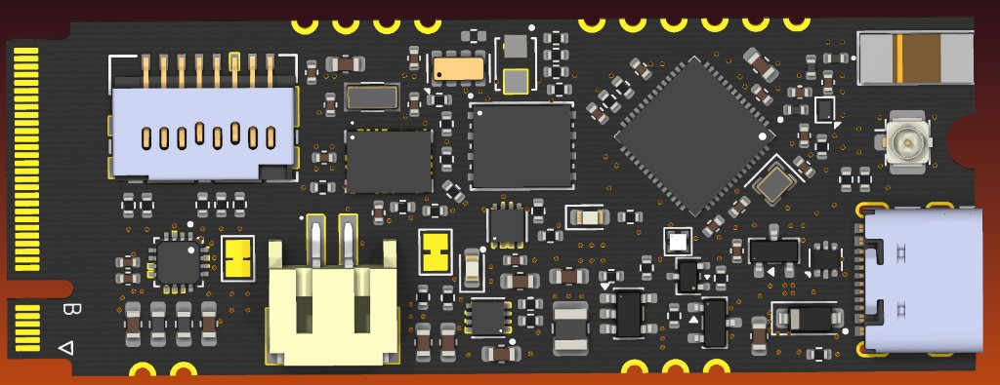

# NX-Edge Hardware Reference Manual

> **Document Version:** 1.0 (Draft)  
> **Hardware Target:** M.2 2260 Key B (6-Layer High-Density Stackup)  
> **Audience:** Embedded Engineers, Makers, and Prop Builders

---

## Table of Contents

1. [Safety & Interconnect Warnings (Read First!)](#1-safety--interconnect-warnings-read-first)
2. [Board Architecture & Subsystem Map](#2-board-architecture--subsystem-map)
3. [Power Delivery & Power-Path Topology (`VIN`, LiPo, Buck)](#3-power-delivery--power-path-topology-vin-lipo-buck)
4. [Battery Management & Fuel Gauge (`MAX17048`)](#4-battery-management--fuel-gauge-max17048)
5. [Smart NeoPixel Power-Cut Architecture (`VN`)](#5-smart-neopixel-power-cut-architecture-vn)
6. [RF Front-End & Dual-Antenna Switching](#6-rf-front-end--dual-antenna-switching)
7. [Onboard Sensors & Real-Time Clock (RTC & IMU)](#7-onboard-sensors--real-time-clock-rtc--imu)
8. [Audio Power Amplifier (`MAX98357A`)](#8-audio-power-amplifier-max98357a)
9. [High-Speed Storage (QSPI Flash & 4-Bit MicroSD)](#9-high-speed-storage-qspi-flash--4-bit-microsd)
10. [Pinout & Interface Tables (Castellated Edge-Pads & M.2-Fingers)](#10-pinout--interface-tables-castellated-edge-pads--m2-fingers)
11. [Software Cheatsheet (GPIOs, I2C Addresses, Quickstart)](#11-software-cheatsheet-gpios-i2c-addresses-quickstart)

---

## 1. Safety & Interconnect Warnings (Read First!)

> [!CAUTION]
> **NOT A STANDARD PC MOTHERBOARD COMPONENT!**  
> While the NX-Edge mechanically docks into a standard **M.2 Key-B socket**, it utilizes an **independent, custom maker pinout** (similar to SparkFun MicroMod).  
> The M.2 connector carries raw battery voltage (`VBAT`), unregulated $5\text{V}$, Class-D speaker outputs, and $3.3\text{V}$ GPIOs.  
> **DO NOT insert this board into a desktop PC, laptop motherboard, or standard off-the-shelf M.2 NVMe/SATA USB enclosure.**

* **Maximum Input Voltage on `VBUS` (USB-C):** $5.5\text{V}$ (Standard USB 5V rail).
* **Maximum Input Voltage on `VBAT` (JST-PH):** $4.2\text{V}$ (1S LiPo / Li-Ion single cell).
* **Logic Level:** Pure $3.3\text{V}$. ESP32-S3 GPIOs are **NOT 5V-tolerant**!

---

## 2. Board Architecture & Subsystem Map

<p align="center">
  
</p>
<p align="center">
  <em>NX-Edge Top-Down Orthographic Raytraced View (M.2 2260 Key B Single-Sided Layout).</em>
</p>

---

## 3. Power Delivery & Power-Path Topology (`VIN`, LiPo, Buck)

The NX-Edge features an autonomous, low-loss **Power-Path management circuit** that transitions seamlessly between USB power and battery operation:

```text
  USB-C (VBUS 5V) ──► [Schottky D2] ─────────┐
                                              │
  LiPo (VBAT) ────► [Hard-Cut JP2] ──► [Q1] ──┴─► [ VIN ] (System Rail ~4.2 - 5.0V)
                                        ▲           │
                                        │ Gate      ├─► [TLV62569 Buck] ──► +3V3 (2.0A)
                                  (VBUS Controlled) │
                                                    └─► [NeoPixel / Audio]
```

### The Hard-Cut Solder Jumper `JP2` (True 0µA Standby)
Located directly between the positive terminal of the JST battery connector and the internal `VBAT` net is solder jumper **`JP2`**:
* **Default Configuration:** Bridged with solder. Battery power feeds the system directly.
* **External Power Switch Mode:** Cut the copper trace / solder bridge and wire the two pads to an external mechanical toggle or slide switch mounted on your project chassis/hilt. This achieves **true $0.0\,\mu\text{A}$ zero-drain standby** when stored long-term.

<!-- IMAGE PLACEHOLDER: JP2 DETAIL -->
> 📷 **IMAGE 2 NEEDED:** *Close-up crop of solder jumper JP2 and the JST-PH connector.*

---

## 4. Battery Management & Fuel Gauge (`MAX17048`)

* **Autonomous LiPo Charger (`BQ25170`):** Automatically charges single-cell 1S LiPo/Li-Ion batteries at $600\text{–}800\,\text{mA}$. An onboard status LED illuminates during active charging.
* **ModelGauge™ Fuel Gauge (`MAX17048G`):**
  * I2C Address: **`0x36`**
  * Senses cell voltage ($V_{CELL}$) directly at the battery terminal with zero trace IR-drop distortion.
  * Calculates real-time **State of Charge (SoC %)** and discharge rate using Maxim's ModelGauge algorithm without requiring a bulky current-sense shunt.
  * Low-battery alert interrupt wired to **`IO7`** (can wake the ESP32-S3 from deep sleep).

---

## 5. Smart NeoPixel Power-Cut Architecture (`VN`)

Addressable RGB LEDs (WS2812B/SK6812) draw roughly $1\,\text{mA}$ quiescent quiescent current per pixel even when displaying black. To preserve battery life in portable builds, the NX-Edge integrates a dedicated hardware power switch:

* **High-Side Switch:** P-Channel MOSFET `Q2` (DMP3130L-7), driven by NPN BJT `Q3`.
* **Control Pin:** **`GPIO12`** (`CTRL_NP`).
  * `digitalWrite(12, HIGH)` -> Switched rail `VN` is **ACTIVE** ($5\text{V}$ on USB / $V_{BAT}$ on battery).
  * `digitalWrite(12, LOW)` -> Switched rail `VN` is **DISCONNECTED** ($0.0\text{V}$, true zero quiescent leakage).
* **Onboard RGB Status LED:** Sourced directly from `VN` with data driven from **`IO4`**.
* **Edge Breakout:** Three castellated pads along the top-right perimeter carry `VN`, `NPD_IN` (data), and `GND` for direct connection to external strips.

> [!WARNING]
> **USB Brownout Precautions:**  
> Driving 30–60 NeoPixels at 100% white can pull $>2.0\text{A}$ of instantaneous current. When running on USB without a battery connected, weak host ports or passive hubs will sag and trigger an MCU brownout reset. Always clamp peak power in software when operating strictly on USB:  
> `FastLED.setMaxPowerInVoltsAndMilliamps(5, 1000);`  
> When a LiPo battery is attached, the cell naturally buffers high-current transient spikes.

---

## 6. RF Front-End & Dual-Antenna Switching

The board incorporates two RF paths with low insertion loss:

* **RF Switch IC:** Infineon `BGS12WN6` ($0.7 \times 1.1\text{ mm}$ SPDT).
* **Control Pin:** **`GPIO10`** (`RF_CTRL`).
  * **`LOW` (Default):** Onboard high-efficiency **Ignion NN02-201** ceramic chip antenna active.
  * **`HIGH`:** Miniature **Hirose U.FL / IPEX** receptacle active (for routing out of metal, carbon fiber, or shielded housings).

---

## 7. Onboard Sensors & Real-Time Clock (RTC & IMU)

### 9-DOF IMU Co-Processor (`BNO085`)
* **I2C Address:** **`0x4A`** (Default)
* **Oscillator:** Dedicated $32.768\,\text{kHz}$ quartz crystal for drift-free Hillcrest Labs sensor-fusion algorithms (rotation vectors, quaternions, tap detection).
* **Interrupt:** `!INT_DOF` on **`IO5`** (deep-sleep wake capable).

### Ultra-Low-Power RTC (`RV-3028-C7`)
* **I2C Address:** **`0x52`**
* **Current Consumption:** Industry-leading $45\,\text{nA}$ typical.
* **Interrupt / Alarm:** `!INT_RTC` on **`IO6`** (deep-sleep wake capable).
* **Flexible Backup Power Options:**
  1. **Option A (Onboard SMD Supercapacitor):** Mounted directly to the footprint. Solder-bridge the `R-CHARGE` pad with a $0\,\Omega$ link; the RV-3028's internal programmable trickle charger maintains supercap voltage automatically over I2C.
  2. **Option B (External Primary Cell):** Solder flying leads to an external coin cell holder (e.g. CR1220). **Leave `R-CHARGE` unpopulated** to prevent reverse-charging non-rechargeable cells.

// TODO AND WHAT IS RCHAGRED USED FOR? OR WHEEN IS IT USEFUL?

<!-- IMAGE PLACEHOLDER: RTC BACKUP DETAIL -->
> 📷 **IMAGE 3 NEEDED:** *Close-up crop of the RV-3028, supercapacitor pads, and the R-CHARGE jumper.*

---

## 8. Audio Power Amplifier (`MAX98357A`)

* **Type:** Filterless I2S Mono Class-D amplifier delivering up to **$3.2\text{W}$ into $4\,\Omega$**.
* **Power Supply:** Powered directly from `VIN` for maximum audio dynamic headroom.
* **Digital I2S Pinout:**
  * Bit Clock (`BCLK`): **`IO33`**
  * Serial Data (`DIN`): **`IO34`**
  * Word Select / Left-Right Clock (`LRCLK`): **`IO35`**
* **Speaker Output:** Two dedicated castellated pads on the perimeter (`SPK+` / `SPK-`).
* *(Note: Hardware gain resistor option planned for Revision 1.1).*

---

## 9. High-Speed Storage (QSPI Flash & 4-Bit MicroSD)

* **16 MB QSPI Flash:** Winbond `W25Q128JVPIQ` (WSON-8). Routed via internal stripline traces on Layer 3 for clock speeds up to $80\text{ MHz}$.
* **MicroSD Socket:** Molex 105162 push-pull slot operating in native **Hardware 4-Bit SDMMC Slot 1 mode** (avoids slow SPI bottlenecks):
  * `CLK`: **`IO39`** (`MTCK`)
  * `CMD`: **`IO38`**
  * `DAT0`: **`IO40`** (`MTDO`)
  * `DAT1`: **`IO41`** (`MTDI`)
  * `DAT2`: **`IO42`** (`MTMS`)
  * `DAT3`: **`IO2`**
  * *Throughput:* Up to $30\text{–}40\,\text{MB/s}$ via DMA for high-fidelity audio WAV streaming and real-time graphics.

---

## 10. Pinout & Interface Tables (Castellated Edge-Pads & M.2-Fingers)

### Castellated Edge-Pads Summary

<!-- IMAGE PLACEHOLDER: EDGE PADS PINOUT -->
> 📷 **IMAGE 4 NEEDED:** *Annotated graphic showing the castellated edge-pad pinout on both sides.*

| Edge / Position | Group | Pin # | Signal Name | Function Description |
| :--- | :--- | :---: | :--- | :--- |
| **Right (Top)** | **NeoPixel Bus** | 1 | `GND` | Ground return for external LED strips |
| | | 2 | `NPD_IN` | 3.3V Data Drive (GPIO4) |
| | | 3 | `VN` | Switched Power Rail (5V on USB / VBAT on battery) |
| **Right (Bottom)**| **Audio Output** | 1 | `SPK+` | Positive Speaker Output (Class-D bridge-tied load) |
| | | 2 | `SPK-` | Negative Speaker Output (Class-D bridge-tied load) |
| **Left (Bottom)** | **I2C & Serial** | 1 | `IO9` | Shared I2C Bus: **SCL** |
| | | 2 | `IO8` | Shared I2C Bus: **SDA** |
| | | 3 | `RX` | UART0: **RX** (ESP32-S3 Hardware Serial In) |
| | | 4 | `TX` | UART0: **TX** (ESP32-S3 Hardware Serial Out) |
| **Left (Top)** | **Power & Logic** | 1 | `VBUS` | 5V USB Input / Output |
| | | 2 | `+3V3` | 3.3V System Buck Rail (up to 2.0A) |
| | | 3 | `RST` | Hardware Reset (active low) |
| | | 4 | `IO1` | ADC1_CH0 • Touch 1 • RTC Wakeup • PWM |
| | | 5 | `IO11` | ADC2_CH0 • Touch 11 • RTC Wakeup • PWM |
| | | 6 | `GND` | System Ground |

---

## 11. Software Cheatsheet (GPIOs, I2C Addresses, Quickstart)

### I2C Address Map (Shared Bus on `IO8` / `IO9`)

| Device | Subsystem Function | 7-Bit Address (Hex) |
| :--- | :--- | :---: |
| **`MAX17048`** | ModelGauge™ LiPo Fuel Gauge | **`0x36`** |
| **`BNO085`** | 9-DOF IMU Sensor Fusion Engine | **`0x4A`** *(Default)* |
| **`RV-3028-C7`** | Extreme Low-Power Real-Time Clock | **`0x52`** |

---

### Minimal Arduino / ESP-IDF Board Initialization

```cpp
#include <Arduino.h>
#include <Wire.h>

#define PIN_LED_BUILTIN   13
#define PIN_NEO_POWER     12
#define PIN_NEO_DATA       4
#define PIN_RF_CTRL       10
#define PIN_I2C_SDA        8
#define PIN_I2C_SCL        9

void setup() {
  // 1. Initialize Hardware Console
  Serial.begin(115200);

  // 2. Configure Onboard User LED
  pinMode(PIN_LED_BUILTIN, OUTPUT);
  digitalWrite(PIN_LED_BUILTIN, HIGH);

  // 3. Enable NeoPixel Power Switch (VN Rail)
  pinMode(PIN_NEO_POWER, OUTPUT);
  digitalWrite(PIN_NEO_POWER, HIGH); // Supplies 5V / VBAT to NeoPixels

  // 4. Set RF Switch to Internal Ceramic Antenna (LOW)
  pinMode(PIN_RF_CTRL, OUTPUT);
  digitalWrite(PIN_RF_CTRL, LOW);    // LOW = Ceramic Chip, HIGH = U.FL

  // 5. Initialize Shared I2C Bus
  Wire.begin(PIN_I2C_SDA, PIN_I2C_SCL, 400000); // 400 kHz Fast Mode
}

void loop() {
  // Simple Heartbeat Blink
  digitalWrite(PIN_LED_BUILTIN, HIGH);
  delay(500);
  digitalWrite(PIN_LED_BUILTIN, LOW);
  delay(500);
}
```
